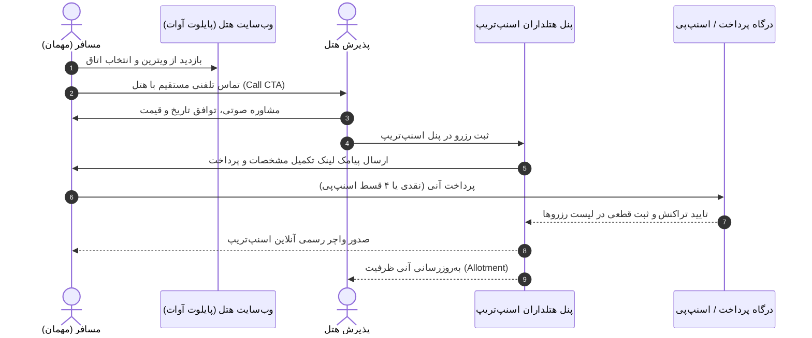

# پروژه پایلوت تبدیل تماس‌های مستقیم به رزرو قطعی
## Direct Call-to-Booking Conversion Engine
### نمونه پیاده‌سازی‌شده بر روی هتل آوات اصفهان

**ارائه‌دهنده:** تیم توسعه محصول و نوآوری اسنپ‌تریپ  
**موضوع:** افزایش تقاضای رزرو تلفنی، ارسال لینک پرداخت پیامکی از پنل هتلداران و ثبت آنی در پلتفرم اسنپ‌تریپ  

---

## ۱. صورت مسئله و فرصت پنهان بازار (Problem & Opportunity)

### چالش جاری هتل‌های بوتیک و سنتی:
* **تمایل بالا به تماس تلفنی:** بیش از **۶۰٪ مسافران** هتل‌های بوتیک و لوکس، به دلیل حساسیت روی انتخاب نوع اتاق (ارسی، تالار آیینه، پنج‌دری) و دریافت مشاوره، ترجیح می‌دهند **ابتدا تماس تلفنی** بگیرند.
* **نشتی شدید درآمد (Revenue Leakage):** بخش بزرگی از این تماس‌ها به دلیل نبود فرآیند پرداخت آنی در لحظه مکالمه، تعلل مسافر در واریز کارت‌به‌کارت، یا کنسلی‌های پیگیری‌نشده **می‌سوزند**.
* **عملیات دستی و خطای انسانی:** دریافت فیش واریزی در واتس‌اپ و ثبت دستی در دفاتر یا نرم‌افزارهای سنتی هتل.

### فرصت طلایی اسنپ‌تریپ:
> تبدیل پلتفرم اسنپ‌تریپ از یک OTA صرف به **سیستم عامل فروش هتلدار (Hotel Operating System)**؛ تصاحب گردش مالی رزروهای تلفنی آفلاین و ثبت آن‌ها درون اکوسیستم اسنپ‌تریپ.

---

## ۲. مدل عملیاتی پروژه (End-to-End Operational Workflow)



---

## ۳. معرفی پایلوت: هتل آوات اصفهان

برای سنجش دقیق بازار و ارزیابی رفتار واقعی مسافر و هتلدار، **هتل آوات اصفهان** به عنوان نمونه پایلوت (Benchmark MVP) انتخاب شد.


### ویژگی‌های کلیدی صفحه اختصاصی هتل:
* طراحی لوکس و ادیتوریال متناسب با ارزش برند هتل و سلیقه گردشگران داخلی و خارجی
* تاکید روی فراخوان‌های شفاف تماس با پذیرش (Call Now) و گفتگوی مستقیم
* بارگذاری فوق‌سریع، سازگاری کامل دو زبانه (فارسی و انگلیسی) و سئوی محلی

---

## ۴. ویترین اتاق‌ها و برگ برنده «پرداخت اقساطی اسنپ‌پی»

یکی از کلیدی‌ترین اهرم‌های بستن فروش پشت تلفن، اعطای قدرت مانور مالی به هتلدار است.


### مکالمه طلایی هتلدار پشت تلفن:
> *«جناب مسافر، شما می‌توانید همین اتاق تالار آیینه را در ۴ قسط بدون کارمزد و بدون ضامن با اسنپ‌پی رزرو کنید. همین الان لینک پرداخت را برایتان پیامک می‌کنم تا رزرو شما قطعی شود!»*

* تعبیه نشان پرداخت اقساطی اسنپ‌پی (Snapp! Pay) در کنار قیمت و دکمه رزرو
* حذف کامل بهانه‌های تعلل مسافر در پرداخت هزینه کل اقامت

---

## ۵. گالری تصاویر غنی؛ حذف تردید مسافر پیش از تماس

مسافر در هتل‌های سنتی به دنبال اصالت و حال‌وهوای واقعی است. کیفیت بصری لندینگ پیش‌نیاز اصلی تمایل مسافر به برقراری تماس است.


* دسته‌بندی موضوعی: فضاهای هتل، اتاق‌ها، صبحانه و خدمات
* لایت‌باکس تعاملی تمام‌صفحه با دکمه مستقیم «رزرو این اتاق» در داخل گالری
* متن‌های اصیل و بدون حشو برگرفته از روایت‌های مستند هتل

---

## ۶. تجربه موبایل (Mobile-First) و اقدام با یک لمس

بیش از **۷۸٪ ترافیک ورودی** از طریق گوشی‌های هوشمند انجام می‌شود. لندینگ به شکلی طراحی شده که تماس تلفنی روان‌ترین مسیر ممکن باشد.


### قابلیت‌های نسخه موبایل:
* **نوار شناور زیرین (Sticky CTA Bar):** دکمه تماس مستقیم با پذیرش همواره در دسترس است.
* **تماس واتس‌اپ با متن آماده:** مسافر با یک لمس وارد گفتگوی رزرو اتاق موردنظر خود می‌شود.
* سازگاری کامل با استانداردهای iOS و اندروید (بدون پرش، زوم ناخواسته یا لگ لمسی).

---

## ۷. ماتریس ارزش‌آفرینی برای سه ذی‌نفع (Value Matrix)

| ذی‌نفع | مزایای کلیدی | نتیجه نهایی |
| :--- | :--- | :--- |
| **هتلدار** | • افزایش نرخ تبدیل تماس‌های ورودی به پول نقد<br>• حذف دردسرهای کارت‌به‌کارت و فیش‌های تقلبی<br>• مدیریت یکپارچه همه رزروها در یک پنل | **رشد درآمد مستقیم و رضایت حداکثری هتلدار** |
| **مسافر** | • امکان مشاوره تلفنی قبل از خرید<br>• پرداخت امن در درگاه رسمی به جای شماره کارت شخصی<br>• امکان خرید اقساطی ۴ ماهه بدون کارمزد | **تجربه رزرو بی‌دغدغه و اعتماد کامل** |
| **اسنپ‌تریپ** | • تصاحب سهم بازار رزروهای تلفنی سنتی (Offline GMV)<br>• عمیق‌تر شدن وابستگی هتلدار به پنل اسنپ‌تریپ<br>• کارمزد روی تراکنش‌های لینک پرداخت | **رهبری بلامنازع بازار و خلق جریان درآمدی نو** |

---

## ۸. شاخص‌های سنجش موفقیت در فاز پایلوت (Success Metrics)

برای تصمیم‌گیری مدیران ارشد جهت تعمیم این راهکار به کل هتل‌های کشور، شاخص‌های زیر مانیتور می‌شوند:

```
[ نرخ تبدیل تماس به رزرو قطعی ] ──── Target: رشد حداقل ۳۵٪
[ میانگین زمان پرداخت پس از ارسال پیامک ] ──── Target: کمتر از ۱۵ دقیقه
[ سهم تراکنش‌های اسنپ‌پی در رزرو تلفنی ] ──── Target: حداقل ۲۵٪ از کل
[ نرخ تکرار هتلدار در صدور لینک ] ──── Target: بیش از ۸۰٪ تماس‌های جدی
[ کاهش خطای Overbooking هتلدار ] ──── Target: کاهش ۱۰۰٪ تداخل اتاق‌ها
```

---

## ۹. مراحل توسعه و نقشه راه تعمیم (Rollout Roadmap)

1. **فاز ۱: آزمایش پایلوت (انجام شد ✅)**
   * پیاده‌سازی لندینگ شاخص و مدرن برای هتل آوات اصفهان
   * بازبینی جریان تماس، سناریوهای پیامک و پنل ثبت رزرو
2. **فاز ۲: ارزیابی داده‌های فروش و بهینه‌سازی Funnel (ماه اول)**
   * رصد تماس‌های تلفنی، نرخ باز شدن لینک‌های SMS و نرخ موفقیت پرداخت
   * مصاحبه با پذیرش هتل برای رفع اصطکاک‌های احتمالی در ثبت پنل
3. **فاز ۳: ارائه ماژول عمومی در پنل هتلداران اسنپ‌تریپ (ماه دوم و سوم)**
   * اضافه شدن قابلیت «صدور لینک پرداخت پیامکی» برای ۲۰۰ هتل بوتیک و بوم‌گردی منتخب
4. **فاز ۴: هوشمندسازی با تلفن گویا و Caller ID ابری (فاز بلندمدت)**
   * تشخیص شماره تماس‌گیرنده، پیشنهاد خودکار اتاق‌های آزاد و ثبت خودکار در پنل

---

## ۱۰. جمع‌بندی و نتیجه‌گیری برای مدیران

> **هدف این پروژه صرفاً طراحی یک وب‌سایت شیک برای یک هتل سنتی نیست؛**  
> بلکه ایجاد یک **موتور رشد فروش تلفنی (Call-to-Booking Growth Engine)** برای اسنپ‌تریپ است که بزرگ‌ترین چالش هتلداران مستقل (تبدیل تماس به پول قطعی) را حل می‌کند و تراکنش‌های خارج از شبکه را وارد گردش مالی اسنپ‌تریپ می‌نماید.

### پیشنهاد برای گام بعدی:
* تایید اجرای پایلوت عملیاتی ۳۰ روزه در هتل آوات اصفهان
* تخصیص سهمیه اعتبار کمپین اسنپ‌پی برای تماس‌های تلفنی این هتل
* آغاز فرآیند استخراج گزارش آماری جهت تصمیم‌گیری نهایی در کمیته محصول

---

**سپاس از همراهی شما**  
*پرسش و پاسخ و بررسی جزئیات فنی و عملیاتی*
